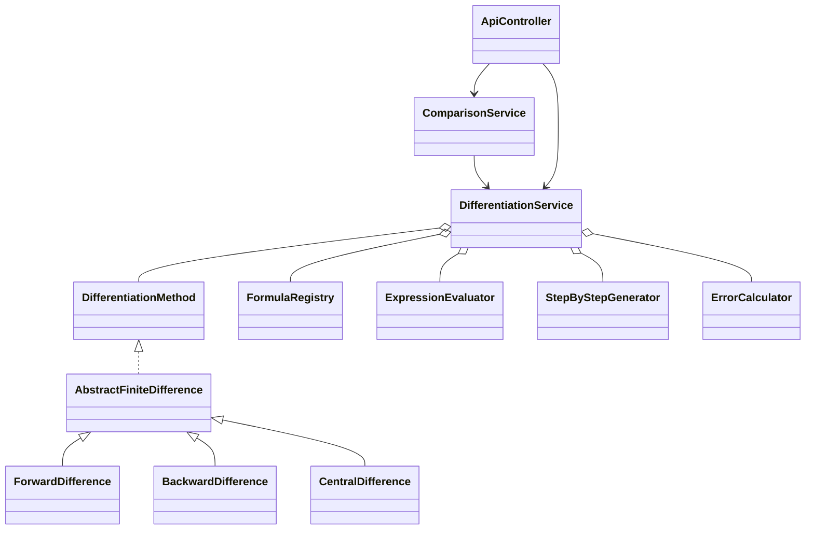

# Implementation report

## A. Implementation summary

Implemented an operational Java 21 / Spring Boot backend and SvelteKit / TypeScript / Tailwind frontend in the previously empty workspace. Java is responsible for the full mathematical pipeline, including graph sampling. The application runs locally as two processes; a production Node adapter includes an API proxy to Java.

## B. Features completed

Calculator, all three difference directions, derivative orders 1–4, 18 formula/accuracy combinations, restricted expression input, formatted preview, nine-step solutions, sample table, interactive Plotly graph, first-derivative tangent/secant, reference-based error analysis, debounced h controls, abort/revision handling, method comparison with domain failures, four analytic examples, learning content, browser-local history, reset, light/dark themes, and responsive layouts. All controls perform an action. Unknown routes produce a 404.

## C. Java OOP architecture

The shared `DifferentiationMethod` interface supplies abstraction and enables polymorphic strategy selection. `AbstractFiniteDifference` owns the common algorithm, and the three named direction classes inherit it. The registry provides immutable formula records with offsets, coefficients, denominator, accuracy, and LaTeX. Private final fields and immutable copied collections encapsulate state. Constructor injection composes the evaluator, registry, strategy list, step generator, and error calculator. HTTP controllers delegate to services. `ComparisonService` reuses the calculation engine instead of implementing another derivative algorithm.



## D. Important files created

- `backend/pom.xml`: Java 21, Spring Boot, validation, exp4j, test dependencies.
- `backend/src/main/java/edu/numerical/formula/FormulaRegistry.java`: all 18 stencils.
- `backend/src/main/java/edu/numerical/method/`: shared algorithm and three strategies.
- `backend/src/main/java/edu/numerical/service/`: mathematical orchestration, expression validation, errors, steps, comparison, graph sampling.
- `backend/src/main/java/edu/numerical/controller/`: four API endpoints and structured errors.
- `backend/src/test/java/edu/numerical/`: parameterized mathematics tests and Spring API integration tests.
- `frontend/src/routes/[[section]]/`: calculator, compare, learn, and history views.
- `frontend/src/routes/api/[...path]/+server.ts`: production API proxy.
- `frontend/src/lib/`: TypeScript contracts, KaTeX and Plotly components.
- `frontend/src/app.css`: responsive design and coordinated themes.
- `frontend/tests/calculator.spec.ts`: browser verification.
- `scripts/`: PowerShell launchers and portable-tool discovery.
- `README.md`: setup, commands, API contract, architecture, deployment, and limits.

## E. Mathematical verification

For every stencil, tests verify the polynomial moments through degree m+p−1, where m is the derivative order and p the accuracy order. The moment of degree m must equal m!, and all other tested moments must vanish after division by the stencil denominator. Separate tests differentiate x^m and verify convergence for exp(x) as h halves. Thus each registered formula receives three independent checks.

The required central O(h²) example evaluates `x^3 + 2*x` at x=2, h=0.1 to approximately 14.01, with reference 14 and absolute error approximately 0.01. Intermediate values are retained as doubles and the displayed solution uses the same samples and compensated sum as the engine.

## F. Test results

- Maven verify: **67 tests passed; 0 failures; 0 errors; 0 skipped**. Includes 63 numerical tests and 4 Spring integration tests. Executable Spring Boot JAR built successfully on Java 21.
- Svelte/TypeScript: **0 errors; 0 warnings**.
- Browser scenarios: **4 passed; 0 failed**, across desktop Chrome and a 390px mobile Chromium viewport.
- Frontend production build: successful. Plotly produces a large-chunk advisory; it is imported lazily.
- HTTP smoke checks: Java health and frontend page returned HTTP 200.
- npm audit after updating KaTeX and overriding cookie to the patched compatible 0.7 line: **0 known vulnerabilities**.

Browser testing covers API-backed results and graph creation, nine steps, automatic h recalculation, reference clearing, invalid domains, second/fourth derivatives, unsupported accuracy avoidance, comparison rows/highlighting, persistent theme, learning navigation, history save/restore/clear, runtime errors, and horizontal overflow.

## G. How to run

Use two VS Code PowerShell terminals from `D:\Projects\Numerical Differentiation`:

```powershell
# Terminal 1
powershell -ExecutionPolicy Bypass -File .\scripts\start-backend.ps1
```

```powershell
# Terminal 2
powershell -ExecutionPolicy Bypass -File .\scripts\start-frontend.ps1
```

Open http://127.0.0.1:5173. The local `.tools` directory contains the required runtimes for this workspace. For a fresh checkout, install Java 21, Maven, and Node 22, then run `npm.cmd ci` inside `frontend`. Full verification and production launch commands are in README.

## H. Known limitations

The calculator uses double precision and cannot guarantee accuracy for poorly conditioned functions or extremely small h. There is no general symbolic derivative engine: references are analytic preset values or user supplied. General user references cannot be independently verified. Finite graph sampling cannot guarantee detection of every discontinuity or narrow feature; invalid samples and detected poles create graph gaps. Large stencils may extend outside the bounded local graph view. Expression preview supports common formatting without being a symbolic parser. History is confined to one browser. Full Plotly has a large lazy-loaded bundle.

## I. Next steps before deployment or submission

For a local demonstration, follow the two launch commands and show the default cubic example, compare view, higher derivatives, solution steps, and error cases. For external deployment, provision Java and Node services, configure the production proxy URL and public ORIGIN, add HTTPS and platform request limits, and run the test commands in CI. Review the report alongside the source; no public deployment has been performed.
